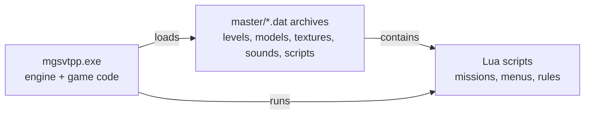

> [!NOTE]
> Generated `from[`docs/guide/Overview.md`](https://github.com/WannabeCoderLuc/mgsvtpp-foxre/blob/main/docs/guide/Overview.md)` on 2026-10-21. Edit the source doc; this page is overwritten on every sync. · [Home](index.md) · [Roadmap](Roadmap.md)

# Guide: What this project is

*Plain-language introduction. The reference pages (formats, engine specs) hold the exact details; this guide explains how the pieces fit together. Refreshed at the end of each milestone.*

## The goal in one paragraph
*Metal Gear Solid V: The Phantom Pain* runs on Konami's **Fox Engine**, whose source code has never been published. This project works out, piece by piece, how the engine stores its data and how it runs a game world, writes that knowledge down as specifications, and re-implements it in a new engine (`Engine/` in the repository). The new engine reads the player's own copy of the game; it contains no Konami code or assets.

## How the game is built

- **The executable** contains both the general engine (file loading, objects, rendering, physics) and the game-specific code (soldiers, vehicles, bosses). It is protected by Denuvo; the project never modifies it and never analyses the protection itself.
- **The data archives** hold everything else: level layouts, models, textures, sounds, navigation meshes and the Lua scripts that describe missions.
- **Lua scripts** decide *what* happens (spawn an enemy, start an event); the executable decides *how* it happens.

## How we learn things
1. **Read the program** (static analysis): decompile functions of the executable and follow the data flow.
2. **Read the data**: write a reader for a file format and test it against *every* file of that type in the game.
3. **Ask the running game** (live checks): start the game, ask it questions through its own Lua interface, and compare its answers with what our tools predicted.

## How we know we are right
Every milestone ends on a test a computer decides: pass or fail. A file reader only counts as correct if it can read and re-write every game file of that type byte for byte; an object loader only counts as correct if the running game reports the same names, classes and positions. `See[How we verify](Guide-Verification.md)`.

## Where we are
| Milestone | What it means | Status |
|---|---|---|
| M0 Foundations | tools, workspace, test runner | PASS |
| M1 Data layer | read every archive, package and core data file | PASS |
| M2 Entities and reflection | turn level data into typed, connected objects | PASS |
| M3 Runtime core | how a frame runs: object manager, updates, messages | IN PROGRESS |
| M4 to M9 | Lua host, world, rendering, animation, gameplay, playable slice | PLANNED |

## Reading order
1. [Game data: from disk to objects](Guide-Game-Data.md)
2. [Classes, properties and entities](Guide-Classes-And-Entities.md)
3. [How a frame runs](Guide-Frame-Loop.md)
4. [How we verify](Guide-Verification.md)
5. [Glossary](Guide-Glossary.md)
