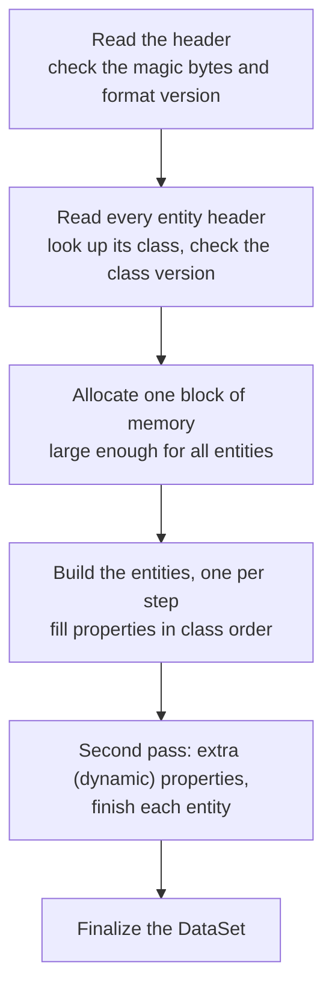

# Classes, properties and entities

*Covers milestone M2 (PASS). Details: [Reflection and type database](../engine/reflection.md), [Entities and DataSet loading](../engine/entities.md). Modding: [Editing fox2 DataSets](../mods/editing-datasets.md).*

## What it is
A DataSet is only a list of numbers until you know what each class and property means. Fox Engine keeps its own catalogue of every data class it knows. With that catalogue, a `.fox2` file becomes a graph of typed objects that point at each other, and those objects become the live things in a level.

## Why it matters
With the engine's own type catalogue a DataSet can be checked, edited and loaded into the new engine, and mods can add entities with exactly the properties the game expects. Without it, any edit is a guess about which bytes mean what.

## How the original does it
### The engine's own catalogue of types
Fox Engine keeps a **class registry**: a list of every data class it knows (1,153 of them). For each class it records

- a **parent class** (a `GameObjectLocator` is a kind of `TransformData`, which is a kind of `Data`, which is a kind of `Entity`),
- its **size in memory** and a **version number**,
- its **properties**: name, type (integer, float, string, vector, reference ...), container (single value, array, list or string map) and position inside the object.

This is called *reflection*: the program can describe its own data structures. The game can even write this catalogue to a file with `Fox.ExportSerializeInfo()`; in the retail build that silently fails only because a `tmp` folder is missing. With the folder in place we asked the game to export, and got all 1,153 classes and 6,062 properties directly from the source.

### From a DataSet file to live objects
When the game loads a DataSet it does the following (read from the executable):

- The loader does **a little work each frame** (one entity per step), so large levels don't freeze the game.
- If a file's entity says class version 2 but the engine's class is version 3, loading stops. That is why every DataSet shipped with the game matches the registry exactly.
- Files that don't start with the binary signature are read as **XML** instead: the engine can also load text DataSets.

### How entities refer to each other
| Kind | Meaning | Example |
|---|---|---|
| **EntityPtr** | "I own this", always in the same file | a locator and its transform |
| **EntityHandle** | "I know this one", same file or another loaded file | a transform and its owner |
| **EntityLink** | "the named object in that other file" (file path + name) | a checkpoint list and each checkpoint |

### From entities to named places
Some entities are **DataIdentifiers**: tables of names linked to other entities. Scripts find objects through them (`DataIdentifier.GetDataWithIdentifier`). An identifier exists while its DataSet is loaded. See [World streaming and the title screen](world-streaming.md).

## How our engine does it
`Engine/core/typedb.py` holds the exported class registry; `Engine/core/entities.py` turns a DataSet into typed entities and resolves all three kinds of reference. For a whole mission (8,669 entities) every pointer resolves; the few links that don't point to files Konami never shipped, or to objects the engine creates while loading.

## How we know
- Every property seen in all 44,994 DataSets matches the exported catalogue (3,372 of 3,372 distinct properties used).
- In Afghanistan free roam we asked the running game for 17 objects through its own Lua function `DataIdentifier.GetDataWithIdentifier`. For all 17, the name, class and world position match what our loader computed from the files alone. That was the M2 pass condition.

## Still open
- The `*_PhysicsData` links of story missions point into `.ph` and `.sim` DataSets; resolved since M7, the physics data itself is PLANNED (M14).
- Which entity classes create which runtime objects is known only for the classes the later milestones needed.

## For modders
- Add or edit entities with the right types: [Editing fox2 DataSets](../mods/editing-datasets.md).
- Look up your own named places from Lua: [Locators and map blocks in a mod](../mods/locators-and-blocks.md).
- Planned: mods register new DataSet classes through the Mod API (M10), loaded by the same path as vanilla classes ([Where things stand for modders](../mods/where-things-stand.md)).

---
<small>Hand-written article (`docs/site/explain/Classes-And-Entities.md`) &middot; published 2026-11-05.</small>
