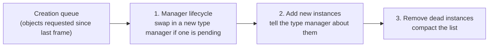
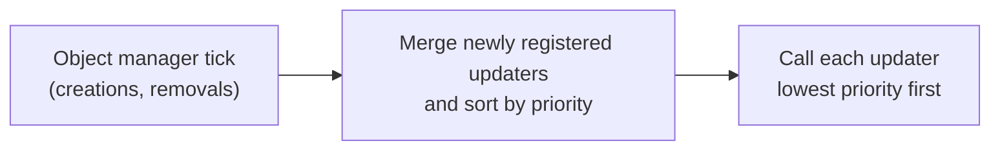

# How a frame runs

*Covers milestone M3 (PASS, 2026-10-22). Details: [Scheduler](../engine/scheduler.md), [Messages and commands](../engine/messages.md). Modding: [Messages and commands in a mod](../mods/messages-and-commands.md).*

## What it is
About 60 times a second the game runs one frame: it creates and removes objects, then calls a sorted list of systems ("updaters") one after another. Between them, systems and scripts talk through commands and messages.

## Why it matters
Whether a soldier reacts before or after the player moves, and whether a message arrives this frame or the next, decides how the game feels and whether scripted sequences work. An engine with the right data but the wrong update order would behave differently in small, hard-to-debug ways.

## How the original does it
### Game objects and their ids
Everything that acts in the world (the player, soldiers, vehicles, helicopters, animals, bosses) is a **game object**. Each has a 16-bit **id**: the upper 7 bits are the **type** (0 = player, 2 = soldier, 50 = vehicle ...) and the lower 9 bits are the instance number. One **type manager** per type owns all instances of that type and runs their logic.

### The object manager
A single **GameObjectManager** keeps 128 type slots. Every frame it does three things for each type, in order:

Creating or destroying objects therefore takes effect at a frame boundary, never in the middle of an update.

### The update order
The whole frame is driven by one job on a single thread:

- In free roam there are **18 to 24 updaters** (priorities 0 to 25); a few extra ones exist only while a mission loads.
- When two updaters have the same priority, the one registered first runs first.
- 17 of 24 updaters are named, among them [V]: priority 3 message system, 4 the mission script's `OnUpdate`, 7 search and sight checks, 9 damage, 15 notice sensor, 17 music, 25 the Lua `Util` interval timers. The other 7 have their behaviour decoded but no name.
- Separately, every object type sits in one of **four update groups** (group 1 holds the player, soldiers, helicopters and animals; groups 2 and 3 hold systems such as bullets, pickups and the Fulton). Within a group, types are ordered by type number.

### Messages and commands
Systems talk to each other in three ways:

| Mechanism | Direction | Timing | Example |
|---|---|---|---|
| **Message bus** | engine to any listener | queued; delivered when the listener's queue is drained | `VehicleTrouble(vehicleId, "CanNotMove")` |
| **SendCommand** | Lua to one object | immediate, returns a result | `GameObject.SendCommand(soldierId, {id = "SetAlertRoute", ...})` |
| **SendMessage** | Lua to one object | queued per type, read during that type's update | a custom value for a specific enemy |

A message on the bus carries up to four arguments, each tagged as integer or decimal. A queue holds 128 messages; it is drained until empty, so messages raised during delivery arrive in the same pass. Lua mission scripts receive many of these in `OnMessage`: this is how a mission learns that a vehicle broke down, a timer ended or a base changed phase.

From boot to free roam the game raised 43 bus messages, the same ones in the same order on both boots: the buddy dog appearing (`BuddyAppear`), the title screen's vehicles disappearing (`VehicleDisappeared`, one per vehicle) and two gimmick switches (`SwitchGimmick`).

## How our engine does it
`Engine/runtime/` implements the object manager, the update service and the message bus (128-message queue, drain until empty, hand-back to the same listener). The script host (M4) drains the mission's queue into `OnMessage` once per frame.

## How we know
- A log-only plugin recorded every change of the updater list over two separate boots; both gave exactly the same order, and the engine's gate test replays every change and must produce the same order.
- The 43-message boot sequence passes through the engine's bus in the recorded order.
- The queue size, drain rule and hand-back were read in the executable [V static] and are pinned by tests.

## Still open
- 7 updaters have no name yet.
- Where the frame drains the mission's queue relative to the mission's `OnUpdate`.
- The engine-side listener that would route bus messages to a type manager was never called in three traced boots; what triggers it is unknown.

## For modders
- React to events and send commands: [Messages and commands in a mod](../mods/messages-and-commands.md).
- Mods add updaters with their own priority, message listeners and ids, object types, command handlers and hooks on command dispatch through the Mod API (M10, PASS: [Writing a mod for the new engine](../mods/mod-api.md)).

---
<small>Hand-written article (`docs/site/explain/Frame-Loop.md`) &middot; published 2026-11-06.</small>
