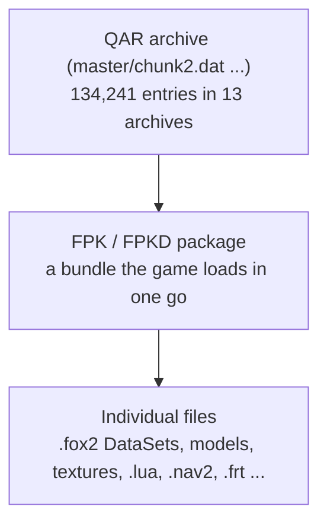
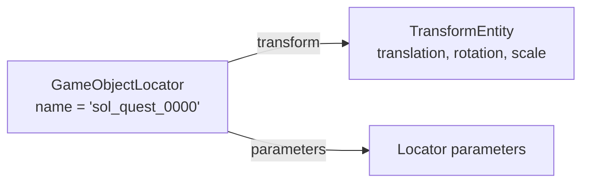

# Game data: from disk to objects

*Covers milestone M1 (PASS). Exact layouts: [QAR](../formats/qar.md), [FPK](../formats/fpk.md), [FOX2](../formats/fox2.md), [FRT](../formats/frt.md), [NAV2](../formats/nav2.md), [FoxData](../formats/foxdata.md). Modding: [Archives, packages and hashes](../mods/archives-and-hashes.md).*

## What it is
Everything the game shows or does starts as bytes in files: level layouts, models, textures, sounds, navigation meshes, patrol routes and Lua scripts. They are stored in three layers of containers, and almost every name inside them is a hash instead of text.

## Why it matters
An engine that cannot read these files exactly cannot load a level. A mod tool that writes them slightly wrong can corrupt a package in ways that only show up as a crash hours later. So the first milestone was to read **and write back** every container and core format exactly.

## How the original does it
### Three layers of containers

1. **QAR archives** (`master\*.dat`) are the large files on disk. Each entry is lightly scrambled with constants that are part of the format (not real encryption) and often zlib-compressed. Every entry carries an MD5 checksum, which proves we decoded it correctly.
2. **FPK / FPKD packages** are bundles inside the archives. The game loads a whole package at once, for example everything one area of the map needs. An `.fpk` holds assets (models, textures, scripts); the matching `.fpkd` holds the **DataSets** that describe how those assets are placed and configured.
3. **Files** inside packages are the actual content. 59 file types occur in packages; DataSets (`.fox2`) are the most common, then `.lba`, models (`.fmdl`) and collision (`.geom`).

### Names are stored as hashes
The archives don't store file names, only a 64-bit hash of each path (*PathCode64*). Inside DataSets, class names, property names and many strings are stored as hashes as well (*StrCode64*). To display names we hash lists of known strings and look for matches. Today 83 % of archive entries have a known name; the rest, mostly textures, have names nobody has found yet. See [Addresses, hashes and tags](../start/conventions.md).

### DataSets (.fox2): how a level is described
A DataSet is a list of **entities**. Each entity has a **class** (for example `GameObjectLocator`, `StaticModel`, `TransformEntity`) and a list of **properties** (name, type, value). A locator for an enemy says, in effect: *my name is X, my position is stored in entity Y, I spawn objects of type Z*.

Fifteen file extensions (`.fox2`, `.parts`, `.tgt`, `.sim`, `.ph` and others) are all DataSets under a different name. What the classes mean is the next topic: [Classes, properties and entities](classes-and-entities.md).

### Other formats
- **.frt route sets**: patrol paths for soldiers and vehicles, made of nodes and events such as "idle here", "walk" or "send a message". Names for 69 of the 104 event types are known.
- **.nav2 navmeshes**: the walkable surface used for path finding ([Routes and navmeshes](routes-and-navmeshes.md)).
- **FoxData** (`.htre`, `.tre2`, `.geom`, `.geoms`, `.gskl`): a node-tree container shared by terrain and collision ([Terrain and collision files](terrain-and-collision.md)).
- **.lua scripts** inside packages are lightly obfuscated with a key from the file name; all 732 decode to readable Lua that compiles.

## How our engine does it
`Engine/formats/` holds one reader and writer per format, in Python, kept apart from the runtime code that uses the data. The hashes live in `Engine/core/` (`strcode.py`, `pathcode.py`). Codecs keep every byte they do not understand, so writing a file back never loses data.

## How we know
For each format we read and re-write **every** file of that type in the game and require the output to be identical byte for byte:

| Format | Files | Result |
|---|---|---|
| QAR entries | 134,241 | every MD5 matches; headers and tables re-encode exactly |
| FPK / FPKD | 16,354 | byte-identical |
| FOX2 DataSets | 44,994 | byte-identical |
| FRT route sets | 307 | byte-identical |
| NAV2 navmeshes | 840 | byte-identical |
| FoxData (terrain, collision) | 9,340 | byte-identical (M7) |

If our understanding of even one field were wrong, at least one file would come out different. The string hash was also checked against the game's own function, run in an emulator, including strings longer than 64 bytes.

## Still open
- 22,847 archive entries have no known name, mostly textures.
- Where the executable parses packages is not located (the game never checks the `foxfpk` magic).
- Model, texture, animation and sound formats are PLANNED (M11).

## For modders
- Writing a file tool: [Archives, packages and hashes](../mods/archives-and-hashes.md), [Editing fox2 DataSets](../mods/editing-datasets.md).
- Getting your own files into a mission: [Add a package to a mission](../mods/add-a-package.md).

---
<small>Hand-written article (`docs/site/explain/Game-Data.md`) &middot; published 2026-11-06.</small>
