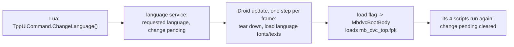

# The iDroid and the language reload

*Milestone M5 (the last piece of its gate, 2026-10-24). Reference: [Resources and mission load, "UI parameter tables"](../engine/resources.md).*

## What it is
The iDroid (internally *MbDvc*, "Mother Base device") is the in-game device with the map, missions and pause help. Its map and help data are four Lua tables: `mbdvc_map_location_parameter.lua`, `mbdvc_map_mbstage_parameter.lua`, `mbdvc_map_mission_parameter.lua` and `mbdvc_pause_help_table.lua`. They are not loose files: they are the scripts of one package, `/Assets/tpp/pack/mbdvc/mb_dvc_top.fpk`.

## Why it matters
These tables reload more often than anything else in the start-up: nine of the 58 chunks after the start-up mission are UI tables. Without knowing why, the engine could not reproduce the boot, and a mod that patches the tables once would silently lose its changes.

## How the original does it

- `ChangeLanguage()` reads the configured language, stores it as the requested one and sets a **change pending** flag. `IsChangeLanguage()` returns that flag, so scripts can wait for the change to finish.
- While the flag is set, the iDroid's per-frame update runs a small **state machine**: if the current language already equals the requested one it stops at once; otherwise it tears down, loads the language's font and text packages, then sets a load flag that makes `MbdvcBootBody` (from `ui_default_data2.fpk`) load `mb_dvc_top.fpk`. When the loads are done, the flag is cleared.
- In a normal start-up **three calls** happen, each a full reload even though the language is the same every time: `TppUiBootInit.lua` during the boot; `init_sequence` after reading the config save (`Seq_Demo_SetSavedLanguage`); and again while loading the save data (`CreateOrLoadSaveData`). The package loads 25, 51 and 51 frames after the call.
- **`emblem_list.lua`** (the emblem catalogue) is loaded by the emblem setup function six frames after the start-up mission's package; that package is the only one in the boot with an `EmblemBlender` entity, the likely trigger.

## How the new engine does it
`Engine/resources/ui.py` (`IDroid`) implements both natives and the state machine. With no file loading delays, the machine takes its decoded number of steps (16 updates to the load, 18 to the end) instead of the 25 to 51 frames IO causes in the game. `mb_dvc_top` loads through the normal package loader, so its scripts run again on every reload. A loader hook runs the emblem setup after a package with an `EmblemBlender` entity.

## How we know it is right
A live capture (two runs) hooked the Lua functions, the state machine, the language-package step, the package load and the emblem setup, and matched every reload to its call. The engine reproduces the 9 UI chunks in their live positions. The first, boot-time load runs on a worker thread at the same time as the boot's library loads; its exact position differed in all three runs we have, so the test checks it as a group in package order.

## Still open
What the language service reports as the "current" language (it never matched the requested one in the boot), and which code calls the emblem setup (it is called from protected code).

---
<small>Hand-written article (`docs/site/explain/IDroid.md`) &middot; published 2026-10-28.</small>
