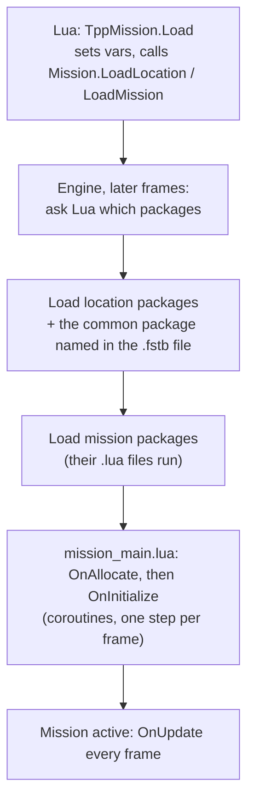

# How a mission loads

*Milestone M5 (PASS, 2026-10-24). Reference: [Resources and mission load](../engine/resources.md).*

## What it is
"Load mission f30010" (Afghanistan free roam) is not one operation. It is a chain: the scripts ask for a location and a mission, the engine asks the scripts which **packages** that means, loads them into memory **blocks**, runs the scripts those packages carry, and then steps the mission's main script into life.

## Why it matters
Package lists are decided in Lua, so this chain is where mods add content without touching the executable. For the new engine it is the backbone of everything after M5: the world (M6 to M8), characters and gameplay all arrive through packages loaded this way.

## How the original does it

1. **Requests, not loads.** `Mission.LoadLocation()` and `Mission.LoadMission()` only latch `vars.locationCode` / `vars.missionCode`. The actual work happens on later frames.
2. **Lua picks the packages.** The engine calls two Lua functions that the scripts registered, `GetLocationPackagePath(code)` and `GetMissionPackagePath(code)`. They return lists of package paths (`TppMissionList` builds them, mission by mission).
3. **Location first.** The location's packages load, plus a *common* package that the stage's `.fstb` file names (for Afghanistan, `afgh_common.fpk`). The mission's packages load only when the location is ready. If only the mission changes, the location stays.
4. **Packages carry code.** Every `.lua` file inside a loaded package runs as soon as the package loads, in reverse of the stored entry order (alphabetical in practice). A script already resident in another loaded package does not run again.
5. **The mission script.** A `TppSimpleMissionData` entity in the mission package names the main script (`mission_main.lua`) and its sub-scripts. The engine runs `OnAllocate(subScripts)` and then `OnInitialize(subScripts)`, each as a coroutine resumed once per frame. When `OnInitialize` returns, the mission is active and gets `OnUpdate` every frame, plus `OnChangeSVars` for script variables marked to notify.
6. **Side content** then loads into [script blocks](script-blocks.md): quests, reinforcements, animals.

## How the new engine does it
- `Engine/resources/loader.py`: the request latches, the location loader, the mission block controller, script resources and their run order.
- `Engine/script/vfs.py`: a **package-scoped file system**: a script inside a package is invisible until the package is mounted, and disappears when it is unloaded. This catches scripts that would only work by accident.
- The save boundary: `TppScriptVars.LoadVarsFromSlot` copies values from a save image recorded live, so "Continue" restores the same quest and animal blocks as the real game.

## How we know it is right
The gate scenario is the live boot: cold start, title screen, Continue, free roam. The engine loads **all 58 script chunks from the start-up mission to the end of the boot in the live order**, with the same location / mission / common-package events and the same script-block slots. The one difference in the live capture is caused by Infinite Heaven's patched `f30010.fpkd` (it adds a script); the test asserts the vanilla order and documents the patch.

## Still open
- The location loader's own per-frame order against the mission block.
- `Mission.RequestToReload` (reload without a location change).
- The title-screen flow itself runs at a boundary for now (see [The Lua script host](script-host.md)).

---
<small>Hand-written article (`docs/site/explain/Mission-Load.md`) &middot; published 2026-10-30.</small>
