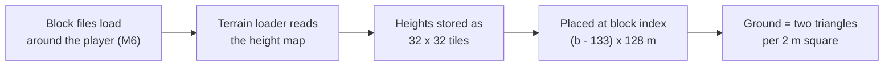

# Terrain and collision files

*Milestone M7 (PASS, 2026-10-29). Reference: [HTRE / TRE2 terrain](../formats/htre.md), [FoxData containers](../formats/foxdata.md), [GEOM collision](../formats/geom.md). Related: [World streaming and the title screen](world-streaming.md).*

## What it is
The ground you walk on and the shapes you bump into come from five file types:

- **`.htre`**: one height map per small map block (128 m × 128 m), 64 × 64 heights, one every 2 m. Afghanistan has 4,096 of them.
- **`.tre2`**: one coarse height map for the whole location, used for the far distance.
- **`.geom` / `.geoms` / `.gskl`**: collision shapes for rocks, buildings and props, and collision skeletons for characters.

All five turned out to be the same container underneath (a "FoxData" tree of named nodes with parameters and data), so one reader handles them all.

## Why it matters
Everything that moves needs the ground: the player stands on it, soldiers walk their routes over it (M8), bullets and grenades hit it (M9), and the renderer draws it (M13). M7 makes the engine answer "how high is the ground here?" for any point, the same way the game does.

## How the original does it

- **Placement.** A block named `afgh_147_129` starts at x = (147 − 133) × 128 m, z = (129 − 133) × 128 m. Rows of the height map go along z (north-south), columns along x. 133 is the same centre index the stage-block grid uses, so a block's file and the block the streaming loads are the same square.
- **Tiles.** Inside the file the 64 × 64 heights are not stored row by row across the whole block: they come as four tiles of 32 × 32 (top-left, top-right, bottom-left, bottom-right), each row by row. Read naively, the ground looks torn into strips.
- **Between samples.** Each 2 m square is split into two triangles along the same diagonal, and the ground is flat on each triangle. That gives slightly different heights than smoothing across all four corners, by up to 10 cm on bumpy ground.
- **The coarse map.** The `.tre2` is every 16th height of the block maps, so far terrain and near terrain agree exactly at those points.

## How the new engine does it
- `Engine/formats/foxdata.py` reads and writes the shared container, `Engine/formats/terrain.py` the terrain on top of it (and undoes the tiling).
- `Engine/world/heightfield.py` builds one height field from the loaded blocks (or the `.tre2`) and answers ground height at any (x, z) with the triangle rule, in 32-bit floats like the game.

## How we know it is right
- **Files:** all 9,340 terrain and collision files are read and written back byte for byte; the 4,164 terrain files are fully typed.
- **The live game:** there is no script function that asks the game for the ground height, so we dropped the player at 36 points in Afghanistan (over 6 blocks) and read where they came to rest. On ground up to 12° steep, all 24 points rest exactly 0.798 m above the engine's ground height, give or take 5 mm (0.798 m is where the game puts the player's position above their feet). Dropping from 1 m or 4 m gives the same result. Smoothing across four corners or splitting along the other diagonal is off by 6–12 cm, so the triangle rule is the game's.
- Steeper slopes hold the player 1–2 cm higher, and 8 drops landed on rocks or props (collision shapes, not terrain), which the test checks as "never below the ground".

## Still open
- Why the player rests 0.798 m above the ground, and where the ±5 mm scatter comes from (probably the physics engine storing heights with less precision).
- The shapes inside `.geom` files (only their container is decoded so far) — needed for collision in M9.
- Two small terrain fields (a 0/1 flag in the patch header, one extra level-of-detail slot).

---
<small>Hand-written article (`docs/site/explain/Terrain-And-Collision.md`) &middot; published 2026-10-29.</small>
