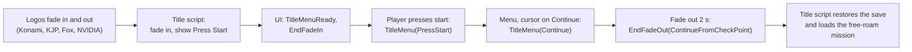

# World streaming and the title screen

*Milestone M6 (PASS, 2026-10-29). Reference: [World streaming and locators](../engine/world.md), [Script host, "Title menu and CONTINUE"](../engine/script-host.md). Related: [How a mission loads](mission-load.md).*

## What it is
Three things the game needs before you can stand in free roam:

- **Locators**: named places in the level data ("where the helicopter's dog stands"). Scripts ask for them by name and get back the object, with its position.
- **Stage blocks**: the map is cut into a grid of small blocks (128 m squares). Around the player, a 5 × 5 window of them is "current", and the large packages that cover that window (a base, a camp) load and unload as the player moves. Scripts hear about it through `Block.*` messages.
- **The title screen**: the helicopter interior with "Press Start" and the menu (Continue, New game). Picking Continue fades the screen to black and loads the mission the save points at.

## Why it matters
Until M6 the engine stopped at the title: the title's script asked for a locator the engine could not find, and the menu and its Continue were pressed by the test itself. Every later milestone (navigation, soldiers, the playable slice) needs the world around the player to be loaded the way the game loads it, and needs to get there the way a player does.

## How the original does it

- **Locators.** Every `DataIdentifier` in a loaded DataSet registers its names in one big table; a lookup by (identifier, key) finds the entity there.
- **Stage blocks.** A controller per location reads the player's start position (from the save's checkpoint), turns it into a block index (`133 + floor(position / 128)`) and checks which large blocks from the location's block table touch the window. It sends `StageBlockCurrentSmallBlockIndexUpdated` when the index changes and `OnChangeLargeBlockState(name, ACTIVE)` when a watched large block finishes loading.
- **The title screen** is one small state machine in the executable's UI. Lua starts it (`StartPressStartMenu`, `StartTitleMenu`); it shows the layouts, waits for the player's button, and sends `UI.TitleMenu` with what was chosen.
- **Fades.** A fade is a timer: `FadeIn(2 seconds, "FadeInOnStartTitle")` darkens or brightens the screen over 2 s; on the first frame after it ends, the UI sends `UI.EndFadeIn` (or `UI.EndFadeOut` if the screen is now black) with the name the script gave. Scripts chain on these names: Continue fades out, and only the `EndFadeOut(ContinueFromCheckPoint)` message makes the title load the mission.
- **Logos.** The title waits until the start-up logos are gone. They play one after another, each 1 s in, 4 s shown, 1 s out; the Fox logo quietly brings an NVIDIA logo along that has to finish too.

## How the new engine does it
- `Engine/world/identifiers.py` builds the locator table from the DataSets the loader mounted and answers the same lookups.
- `Engine/world/stage_blocks.py` runs the stage-block controller with the decoded index rule and the location's block table.
- `Engine/runtime/title.py` has the fade timer and its end messages, the logo screens, the title state machine and the end of the loading tips. The test scenario plays the player: it presses start once the title has faded in, confirms the menu where the cursor starts (Continue), and ends the loading tips when the game asks.

## How we know it is right
- **Locators:** the title asks for the same locators as the real game, in the same order, for both recorded saves, and its set-up finishes.
- **Stage blocks:** the engine sends the same `Block.*` messages as the real game, with the same block indexes and the same large blocks, for a save in Afghanistan and one in Africa.
- **Title menu:** the title messages (TitleMenuReady, EndFadeIn, TitleMenu PressStart, RequestPlayRecordClearInfo, TitleMenuReady, TitleMenu Continue, EndFadeOut ContinueFromCheckPoint) come in the same order as in all four recorded game sessions, and the free-roam mission is loaded by the title's own script. The real game takes 120 frames from the Continue fade-out to the load; the engine 121.
- The native-call comparison with the real game improved: 558 functions called on both sides (was 548), and only 2 called by the real game alone (was 12).

## Still open
- Two title messages (`TitleMenuReady`, `RequestPlayRecordClearInfo`) are sent from protected code we cannot read; the engine sends them where the recordings show them.
- Which of two block lists drives the large-block message, the level-of-detail package lists, small-block streaming and real load times.
- How the button press reaches the title machine (input is not modelled yet; the scenario presses for the player).

---
<small>Hand-written article (`docs/site/explain/World-Streaming.md`) &middot; published 2026-10-30.</small>
