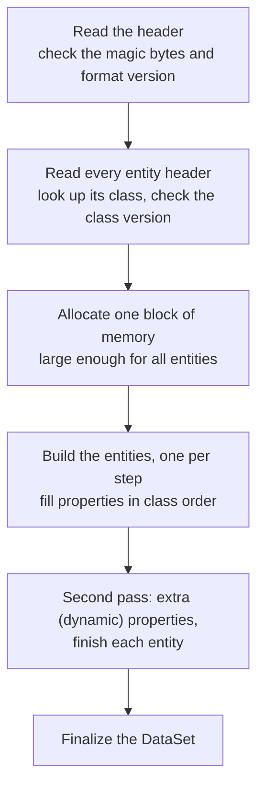

# Classes, properties and entities

*Covers milestone M2. Details: [Reflection and type DB](../engine/reflection.md), [Entities](../engine/entities.md).*

## The engine's own catalogue of types
Fox Engine keeps a **class registry**: a list of every data class it knows (1,153 of them). For each class it records

- a **parent class** (a `GameObjectLocator` is a kind of `TransformData`, which is a kind of `Data`, which is a kind of `Entity`),
- its **size in memory** and a **version number**,
- its **properties**: name, type (integer, float, string, vector, reference ...), container (single value, array, list or string map) and position inside the object.

This is called *reflection*: the program can describe its own data structures. The game can even write this catalogue to a file with `Fox.ExportSerializeInfo()`; in the retail build that silently fails only because a `tmp` folder is missing. With the folder in place we asked the game to export, and got all 1,153 classes and 6,062 properties directly from the source. Every property seen in all 44,994 DataSets matches that catalogue.

## From a DataSet file to live objects
When the game loads a DataSet it does the following (read from the executable):

- The loader does **a little work each frame** (one entity per step), so large levels don't freeze the game.
- If a file's entity says class version 2 but the engine's class is version 3, loading stops. That is why every DataSet shipped with the game matches the registry exactly.
- Files that don't start with the binary signature are read as **XML** instead: the engine can also load text DataSets.

## How entities refer to each other
| Kind | Meaning | Example |
|---|---|---|
| **EntityPtr** | "I own this", always in the same file | a locator and its transform |
| **EntityHandle** | "I know this one", same file or another loaded file | a transform and its owner |
| **EntityLink** | "the named object in that other file" (file path + name) | a checkpoint list and each checkpoint |

The project's loader (`Engine/core/entities.py`) resolves all three. For a whole mission (8,669 entities) every pointer resolves; the few links that don't point to files Konami never shipped, or to objects the engine creates while loading.

## The live check
In Afghanistan free roam we asked the running game for 17 objects through its own Lua function `DataIdentifier.GetDataWithIdentifier`. For all 17, the name, class and world position match what our loader computed from the files alone. That was the M2 pass condition.

---
<small>Source: `docs/guide/Classes-And-Entities.md` in the project repository &middot; generated 2026-10-22.</small>
