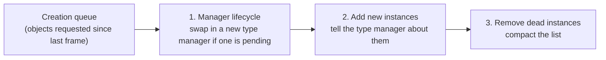
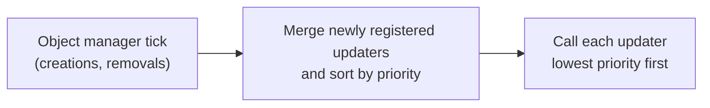

# How a frame runs

*Covers milestone M3 (PASS, 2026-10-22). Details: [Scheduler](../engine/scheduler.md), [Messages and commands](../engine/messages.md).*

## Game objects and their ids
Everything that acts in the world (the player, soldiers, vehicles, helicopters, animals, Sahelanthropus) is a **game object**. Each has a 16-bit **id**: the upper 7 bits are the **type** (0 = player, 2 = soldier, 21 = Sahelanthropus, 50 = vehicle ...) and the lower 9 bits are the instance number. One **type manager** per type owns all instances of that type and runs their logic.

## The object manager
A single **GameObjectManager** keeps 128 type slots. Every frame it does three things for each type, in order:

Creating or destroying objects therefore takes effect at a frame boundary, never in the middle of an update.

## The update order
The whole frame is driven by one job that runs about **60 times per second** on a single thread:

- In free roam there are **18 to 24 updaters** (priorities 0 to 25); a few extra ones exist only while a mission loads.
- When two updaters have the same priority, the one registered first runs first (the game's sort keeps their order).
- Separately, every object type is put into one of **four update groups** (for example group 1 holds the player, soldiers, helicopters and animals; groups 2 and 3 hold systems such as bullets, pickups and the Fulton). Within a group, types are ordered by type number.

We measured this in the running game with a small logging plugin (it only watches, changes nothing) over two separate boots: both gave exactly the same order.

## Messages and commands
Systems talk to each other in three ways:

| Mechanism | Direction | Timing | Example |
|---|---|---|---|
| **Message bus** | engine to any listener | queued, delivered on the next tick of the listener's bucket | `VehicleTrouble(vehicleId, "CanNotMove")` |
| **SendCommand** | Lua to one object | immediate, returns a result | `GameObject.SendCommand(soldierId, {id = "SetAlertRoute", ...})` |
| **SendMessage** | Lua to one object | queued per type, read during that type's update | a custom value for a specific enemy |

A message on the bus carries up to four arguments, each tagged as integer or decimal. Lua mission scripts receive many of these as `Msg` callbacks: this is how a mission learns that a vehicle broke down or a target was eliminated.

From boot to free roam the game raised 43 bus messages, the same ones in the same order on both boots: the buddy dog appearing (`BuddyAppear`), the title screen's vehicles disappearing (`VehicleDisappeared`, one per vehicle) and two gimmick switches (`SwitchGimmick`).

## In the new engine
`Engine/runtime/` implements the object manager, the update service and the message bus. Its gate test replays every change of the updater list seen in the game and must produce exactly the same order, and passes the recorded message sequence through the bus.

## What is still open
- Which game system each updater belongs to (they have no readable names yet).
- Which updater walks the four update groups, and how bus messages reach individual objects.

---
<small>Source: `docs/guide/Frame-Loop.md` in the project repository &middot; generated 2026-10-24.</small>
