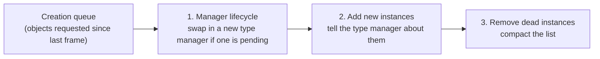

# How a frame runs

*Covers milestone M3 (in progress). Details: [Scheduler](../engine/scheduler.md), [Messages and commands](../engine/messages.md).*

## Game objects and their ids
Everything that acts in the world (the player, soldiers, vehicles, helicopters, animals, Sahelanthropus) is a **game object**. Each has a 16-bit **id**: the upper 7 bits are the **type** (0 = player, 2 = soldier, 21 = Sahelanthropus, 50 = vehicle ...) and the lower 9 bits are the instance number. One **type manager** per type owns all instances of that type and runs their logic.

## The object manager
A single **GameObjectManager** keeps 128 type slots. Every frame it does three things for each type, in order:

Creating or destroying objects therefore takes effect at a frame boundary, never in the middle of an update.

## The update order
After the manager's bookkeeping, a per-frame job calls every registered **updater** (type managers register one each) in order of **priority**, lowest first. Updaters are grouped into four groups. Exactly which systems run in which group, and in what order, is what the M3 live capture will record.

## Messages and commands
Systems talk to each other in three ways:
| Mechanism | Direction | Timing | Example |
|---|---|---|---|
| **Message bus** | engine to any listener | queued, delivered on the next tick of the listener's bucket | `VehicleTrouble(vehicleId, "CanNotMove")` |
| **SendCommand** | Lua to one object | immediate, returns a result | `GameObject.SendCommand(soldierId, {id = "SetAlertRoute", ...})` |
| **SendMessage** | Lua to one object | queued per type, read during that type's update | a custom value for a specific enemy |

A message on the bus carries up to four arguments, each tagged as integer or decimal. Lua mission scripts receive many of these as `Msg` callbacks: this is how a mission learns that a vehicle broke down or a target was eliminated.

## What is still open
- The exact per-frame order across all systems (the M3 live capture).
- Implementing this model in `Engine/runtime/` and checking it against that capture (the M3 gate).

---
<small>Source: `docs/guide/Frame-Loop.md` in the project repository &middot; generated 2026-10-22.</small>
