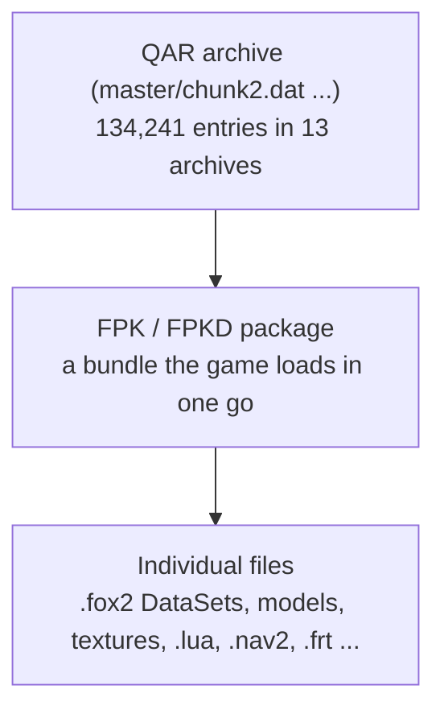
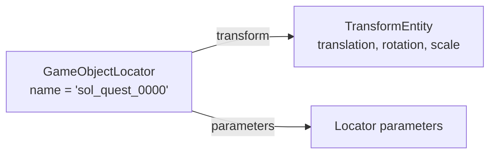

# Game data: from disk to objects

*Covers milestone M1. Exact layouts: [QAR](../formats/qar.md), [FPK](../formats/fpk.md), [FOX2](../formats/fox2.md), [FRT](../formats/frt.md), [NAV2](../formats/nav2.md).*

## Three layers of containers

1. **QAR archives** (`master\*.dat`) are the large files on disk. Each entry is lightly scrambled with fixed constants (not real encryption: the keys are part of the format itself) and often zlib-compressed. Every entry carries an MD5 checksum, which proves we decoded it correctly.
2. **FPK / FPKD packages** are bundles inside the archives. The game loads a whole package at once, for example everything one area of the map needs. An `.fpk` holds assets (models, textures, scripts); the matching `.fpkd` holds the **DataSets** that describe how those assets are placed and configured.
3. **Files** inside packages are the actual content.

## Names are stored as hashes
The archives don't store file names, only a 64-bit hash of each path (*PathCode64*). Inside DataSets, class names, property names and many strings are stored as 48-bit hashes as well (*StrCode64*). To display names we hash lists of known strings and look for matches. Today 83% of archive entries have a known name; the rest, mostly textures, have names nobody has found yet.

## DataSets (.fox2): how a level is described
A DataSet is a list of **entities**. Each entity has a **class** (for example `GameObjectLocator`, `StaticModel`, `TransformEntity`) and a list of **properties** (name, type, value). A locator for an enemy says, in effect: *my name is X, my position is stored in entity Y, I spawn objects of type Z*.

Fifteen file extensions (`.fox2`, `.parts`, `.tgt`, `.sim`, `.ph` and others) are all DataSets under a different name.

## Other formats
- **.frt route sets**: patrol paths for soldiers and vehicles, made of nodes and events such as "idle here", "walk" or "send a message". Names for 69 of the 104 event types are known.
- **.nav2 navmeshes**: the walkable surface used for path finding.
- **.lua scripts** inside packages are lightly obfuscated; all 732 decode to readable Lua that compiles.

## What "done" means here
For each format we read and re-write **every** file of that type in the game and require the output to be identical byte for byte: 44,994 DataSets, 16,354 packages, 840 navmeshes and 307 route sets. If our understanding of even one field were wrong, at least one file would come out different.

---
<small>Source: `docs/guide/Game-Data.md` in the project repository &middot; generated 2026-10-22.</small>
