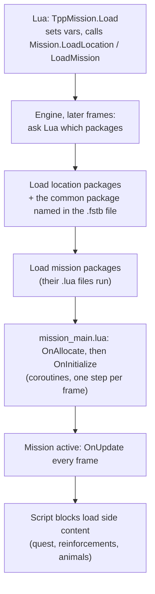

# Scripts and how a mission loads

*Plain-language explanation of milestones M4 (script host) and M5 (resources and mission load). Exact addresses and evidence are on the reference pages [Script host](../engine/script-host.md) and [Resources and mission load](../engine/resources.md).*

## Why scripts matter
Most of what makes MGSV *MGSV* is written in Lua, not in the executable: the start-up sequence, the title screen, which packages a mission needs, where enemies patrol, when a cutscene plays. The executable provides the building blocks (load a file, spawn a soldier, play a sound) as **native functions** that Lua can call. If a new engine runs the game's own Lua and answers those native calls the way the original does, a large part of the game's behaviour comes along for free.

## The script host (M4)
The game uses **stock Lua 5.1** with one internal change (where a string keeps its characters), so the new engine can use an ordinary Lua 5.1 interpreter. What it must add is the API: the game registers **5,532 native functions in 399 libraries** at start-up, through four different mechanisms. We captured that list from the running game, so the engine creates exactly the same libraries at exactly the same moment of the boot.

Many natives only make sense with a full engine behind them (rendering, physics, AI). For those the engine uses **record and replay**: a log-only plugin (FoxTrace) records what each native returned in a real session, and the engine answers with those recordings. The rest are implemented from the decompiled code (for example `ScriptBlock.*`, the mission loader, the language change below).

How we check it: the game loads **170 script chunks** from cold boot to free roam (`f30010`). The engine must load the same chunks in the same order.

## Packages carry code
The game never "runs a script file" directly during a mission load. Instead, **packages** (`.fpk` / `.fpkd`) contain `.lua` files, and every `.lua` file in a package runs as soon as that package is loaded. Within one package they run in reverse of their stored order (alphabetical, in practice). A table the script returns becomes a global named after the file.

So "load mission f30010" really means "load these packages", and the scripts come with them.

## How a mission loads (M5)

1. Lua only **requests** a load; the engine does it on the following frames.
2. The engine asks two Lua functions which packages a location and a mission need. That is why mods can add packages without touching the executable.
3. The location loads first, the mission only when the location is ready.
4. The mission's main script gets `OnAllocate` and `OnInitialize`, each resumed once per frame until it finishes; then the mission is active.
5. **Script blocks** are 8 global slots for side content. Quests, reinforcement helicopters and animals load into them while the mission runs, each with its own `OnAllocate` / `OnInitialize` / `OnUpdate` / `OnTerminate`. Which ones load on "Continue" comes from the save file.

## The iDroid reloads when the language changes
The iDroid's map and pause-menu tables are scripts in one package, `mb_dvc_top.fpk`. The UI loads that package **every time the language is applied** (`TppUiCommand.ChangeLanguage()`), as the last step of a small state machine that also reloads the fonts and texts for the language. During a normal start-up this happens **three times**: once while the engine boots, once after the game reads the config save, and once more while it loads the save data. Each time the four tables run again. A fourth UI script, `emblem_list.lua`, is loaded by the emblem setup a few frames after the start-up mission's package.

This was the last piece of M5: before it was decoded, the engine reproduced every chunk of the boot except these nine.

## Where M5 stands: PASS
From the start-up mission to free roam the engine loads **all 58 script chunks in the live order** (live chunks 112 to 169), with the same block events and script-block slots. The cold boot before that (112 chunks) matches too; the one place where the order is not fixed is the first iDroid load, which runs on a worker thread at the same time as the boot's library loads and lands in a different spot in every real run, so the test checks it as a group.

Two honest limits:

- The start-up mission's title screen flow (logos, language, save loading, title menu) is not run by the engine yet: it starts on a timer message, and the engine has no timers or message delivery to scripts so far. The test makes the flow's native requests (two language changes, then the title and mission loads) at that boundary. Timers and messages are part of the M4 gate.
- One script error remains in the heli-space title mission: it asks the world for a locator the engine does not have before world data exists (M6).

## What comes next
- **M4 gate:** timers and message delivery, the remaining unanswered natives, and a comparison of the full native call log against a live session.
- **Mod checkpoint:** a short break to apply M0 to M5 to the Sahelanthropus mod.
- **M6 World:** stage blocks, world streaming and locators.

---
<small>Source: `docs/guide/Scripts-And-Missions.md` in the project repository &middot; generated 2026-10-24.</small>
