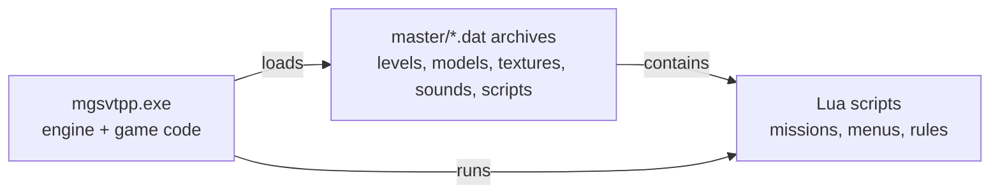

# What this project is

*Plain-language introduction. The Reference sections hold the exact details; the Explanations show how the pieces fit together. Hand-written; refreshed at the end of each milestone.*

## The goal in one paragraph
*Metal Gear Solid V: The Phantom Pain* runs on Konami's **Fox Engine**, whose source code has never been published. This project works out, piece by piece, how the engine stores its data and how it runs a game world, writes that knowledge down as specifications, and re-implements it in a new engine (`Engine/` in the repository). The new engine reads the player's own copy of the game; it contains no Konami code or assets.

## How the game is built

- **The executable** contains both the general engine (file loading, objects, rendering, physics) and the game-specific code (soldiers, vehicles, bosses). It is protected by Denuvo; the project never modifies it and never analyses the protection itself.
- **The data archives** hold everything else: level layouts, models, textures, sounds, navigation meshes and the Lua scripts that describe missions.
- **Lua scripts** decide *what* happens (spawn an enemy, start an event); the executable decides *how* it happens.

## How we learn things
1. **Read the program** (static analysis): decompile functions of the executable and follow the data flow.
2. **Read the data**: write a reader for a file format and test it against *every* file of that type in the game.
3. **Ask the running game** (live checks): start the game, ask it questions through its own Lua interface, and compare its answers with what our tools predicted.

## How we know we are right
Every milestone ends on a test a computer decides: pass or fail. A file reader only counts as correct if it can read and re-write every game file of that type byte for byte; an object loader only counts as correct if the running game reports the same names, classes and positions. See [How we verify](../explain/verification.md).

## Where we are
| Milestone | What it means | Status |
|---|---|---|
| M0 Foundations | tools, workspace, test runner | PASS |
| M1 Data layer | read every archive, package and core data file | PASS |
| M2 Entities and reflection | turn level data into typed, connected objects | PASS |
| M3 Runtime core | how a frame runs: object manager, updates, messages | PASS |
| M4 Script host | run the game's own Lua scripts against recorded engine answers | PASS |
| M5 Resources and mission load | packs, blocks and how a mission gets loaded | PASS |
| M6 World streaming and locators | the blocks of the map that load around the player, how scripts find named places, the title screen | PASS |
| M7 Terrain and collision | read the ground height maps and collision shapes | PLANNED (next) |
| M8 Navigation and routes | path finding on the navmesh and soldiers walking their routes | PLANNED |
| M9 Gameplay core | soldiers, alert phases, noticing, damage, commands (no graphics) | PLANNED |
| M10 Asset formats | textures, models, skeletons, outfit and language files | PLANNED |
| M11 Animation | animation clips and motion graphs | PLANNED |
| M12 Gameplay extended | sound, bosses, menus and the iDroid | PLANNED |
| M13 Rendering | drawing the world | PLANNED |
| M14 Playable slice | one free-roam area with the player and one kind of enemy | PLANNED |

M6 passed on 2026-10-29: the engine finds the level's named places, loads the map blocks around the player with the same messages as the real game, and gets from the start-up screens through the title menu's own Continue to free roam, for a save in Afghanistan and one in Africa (see [World streaming and the title screen](../explain/world-streaming.md)). M5 passed on 2026-10-24: from the start-up mission to free roam the engine loads all 58 script chunks in the same order as the real game, including the iDroid's UI tables (see [The iDroid and the language reload](../explain/idroid.md)). M4 passed on 2026-10-29: the engine follows a real save from the start-up screens to free roam, running the game's own scripts with timers, popups and messages, and the engine functions they call match a recording of the real game except for a short, explained list (see [How we verify](../explain/verification.md)).

The milestones from M6 on were re-ordered on 2026-10-29 so that each one only needs what came before it, and the next one is always the most doable. Next is M7: reading the ground height maps and collision shapes, file-format work like M1. Navigation (M8) follows, then gameplay, assets, animation, and drawing the world last.

## Where to go next
- New here: [How to use this site](how-to-read.md), then the [Explanations](../explain/game-data.md) in order.
- Modding: [Modding guides](../mods/for-modders.md).
- Exact details (addresses, layouts, evidence): the Reference sections ([engine](../engine/modules.md), [file formats](../formats/qar.md)).
- Sources, tools, test fixtures and captures: [Library](../library/sources.md).

---
<small>Hand-written article (`docs/site/start/Overview.md`) &middot; published 2026-10-29.</small>
