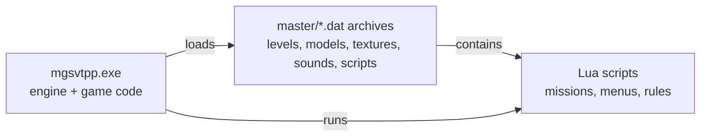

# What this project is

*Plain-language introduction. The Reference sections hold the exact details; the Explanations show how the pieces fit together. Hand-written; refreshed at the end of each milestone.*

## The goal in one paragraph
*Metal Gear Solid V: The Phantom Pain* runs on Konami's **Fox Engine**, whose source code has never been published. This project works out, piece by piece, how the engine stores its data and how it runs a game world, writes that knowledge down as specifications, and re-implements it in a new engine (`Engine/` in the repository). The new engine reads the player's own copy of the game; it contains no Konami code or assets.

## How the game is built

- **The executable** contains both the general engine (file loading, objects, rendering, physics) and the game-specific code (soldiers, vehicles, bosses). It is protected by Denuvo; the project never modifies it and never analyses the protection itself.
- **The data archives** hold everything else: level layouts, models, textures, sounds, navigation meshes and the Lua scripts that describe missions.
- **Lua scripts** decide *what* happens (spawn an enemy, start an event); the executable decides *how* it happens.

## How we learn things
1. **Read the program** (static analysis): decompile functions of the executable and follow the data flow.
2. **Read the data**: write a reader for a file format and test it against *every* file of that type in the game.
3. **Ask the running game** (live checks): start the game, ask it questions through its own Lua interface, and compare its answers with what our tools predicted.

## How we know we are right
Every milestone ends on a test a computer decides: pass or fail. A file reader only counts as correct if it can read and re-write every game file of that type byte for byte; an object loader only counts as correct if the running game reports the same names, classes and positions. See [How we verify](../explain/verification.md).

## Where we are
| Milestone | What it means | Status |
|---|---|---|
| M0 Foundations | tools, workspace, test runner | PASS |
| M1 Data layer | read every archive, package and core data file | PASS |
| M2 Entities and reflection | turn level data into typed, connected objects | PASS |
| M3 Runtime core | how a frame runs: object manager, updates, messages | PASS |
| M4 Script host | run the game's own Lua scripts against recorded engine answers | PASS |
| M5 Resources and mission load | packs, blocks and how a mission gets loaded | PASS |
| M6 World streaming and locators | the blocks of the map that load around the player, how scripts find named places, the title screen | PASS |
| M7 Terrain and collision | read the ground height maps and collision shapes, answer the ground height anywhere | PASS |
| M8 Navigation and routes | path finding on the navmesh, far soldiers walking their routes | PASS |
| M9 Gameplay core | soldiers, alert phases, noticing, soldiers following routes near the player (no graphics) | PASS |
| M10 Mod API core | the engine's own systems opened up for mods: register new systems, hook and extend existing ones | PASS |
| M11 Asset formats | textures, models, skeletons, outfit, language and sound container files | PLANNED |
| M12 Sound and UI logic | which sounds and music the game asks for, menus, the iDroid and the HUD (no playback or drawing yet) | PLANNED |
| M13 Open world complete | both maps fully streamed, clock, weather and the game's random numbers | PLANNED |
| M14 Collision and physics | collision queries, how the player and soldiers move against the world, moving objects | PLANNED |
| M15 Combat and equipment | weapons, bullets, hits, damage, close combat, items and the Fulton | PLANNED |
| M16 Animation | animation clips, motion graphs and ragdolls | PLANNED |
| M17 Headless slice | one free-roam area, the player and one kind of enemy, replayed from recorded input without graphics | PLANNED |
| M18 Full cast | every soldier type, animals, buddies, the helicopter, vehicles and bosses | PLANNED |
| M19 Missions and progression | missions, cutscene logic, Mother Base and save files | PLANNED |
| M20 Rendering | drawing the world | PLANNED |
| M21 Audio output | playing the game's sounds | PLANNED |
| M22 Playable game | graphics, sound and controls on top of the checked game logic | PLANNED |
| M23 Standalone runtime | a fast native engine that installs against your own copy of the game | PLANNED |
| M24 Mod platform 1.0 | a frozen, documented mod interface, asset packs and native plugins | PLANNED |

Alongside these runs a mod track (MOD-A to MOD-E): editors and checkers for game files, an AI sandbox, importers for models and animations, world and navmesh authoring, and an enhanced renderer. MOD-A, tools for the original game (file writers, a route editor, a navmesh baker, a mod-Lua test harness), is in scope since 2026-11-05 and comes next: each tool is checked offline first, then its output is tested in the game.

M8 passed on 2026-11-01: the engine plans the same paths as the real game on 948 of 948 recorded path jobs, within 10 cm, in Afghanistan free roam (see [Routes and navmeshes](../explain/routes-and-navmeshes.md)). Obstacles and ladders are replayed from recordings for now, because what creates them in the game is not decoded yet.

The milestones from M6 on were re-ordered on 2026-10-29 so that each one only needs what came before it, and the next one is always the most doable.

M9 passed on 2026-11-04, with all six gate items checked against the real game: which 18 soldiers are fully simulated, how they follow routes far from and near the player (including why some idle waits run long), the alert phase timers, what really ends a phase (the base's radio reports, which wait for the soldiers it sent to investigate), the same chain at a second base, and why an alert lingers: while the player stays within 10 m of where a soldier last saw them, the last tenth of the alert timer runs 100 times slower. Damage and most script commands were not part of M9; they come with M15 (combat) and the M10 registries. See [How soldiers think](../explain/soldier-ai.md).

M10 Mod API core passed on 2026-11-05, with all 14 gate checks: the systems built so far are opened up for mods. Ten kinds of registries hold everything the engine runs, from object types and commands to measured constants and the game's Lua libraries; the original game's content is registered by a built-in "vanilla" mod through the same calls a mod makes. A manifest and loader put mods in a documented order and refuse conflicts with the mod named; hooks at three engine calls (a soldier's route switch, a base's phase change, command dispatch) let mods watch, change or stop them; Lua mods run in a sandbox. Nine reference mods each change exactly what they predict, and an empty mod changes nothing. The same scenarios run twice, and once more in a fresh process, give byte-identical results, and every recording the tests read is traced back to agreeing live runs. See [How mods plug into the engine](../explain/mod-api.md).

Also under M10, the engine's two busiest pieces (ground height and path finding) got a C++ copy that gives bit-identical answers to the Python version and runs about 19 times faster on path jobs; it is now the default, and every new engine system is written in C++. See [The C++ backend](../explain/native-backend.md).

**Now: M11 Asset formats** (next): readers and writers for textures, models, skeletons, outfits, language and sound container files, checked against every game file. Alongside it, MOD-A: tools for modding the original game.

On 2026-11-04 the order from M10 on was cut again, for two reasons. First, the engine should become something modders can build on, so the mod interface comes right after M9, while the engine's systems are still few and easy to open up. Second, the order follows what is most doable: work on what already exists first, then file formats, then systems the game already reveals through its scripts, then new runtime work, and the outputs (graphics, sound, the playable game) last. Every milestone still ends on a pass-or-fail test against the real game, now listed item by item.

## Where to go next
- New here: [How to use this site](how-to-read.md), then the [Explanations](../explain/game-data.md) in order.
- Modding: [Getting started as a modder](modder-start.md), [Where things stand for modders](../mods/where-things-stand.md), then the [Modding guides](../mods/for-modders.md).
- Reading addresses, hashes and tags: [Addresses, hashes and tags](conventions.md).
- Exact details (addresses, layouts, evidence): the Reference sections ([engine](../engine/modules.md), [file formats](../formats/qar.md)).
- Sources, tools, test fixtures and captures: [Library](../library/sources.md).

---
<small>Hand-written article (`docs/site/start/Overview.md`) &middot; published 2026-11-06.</small>
